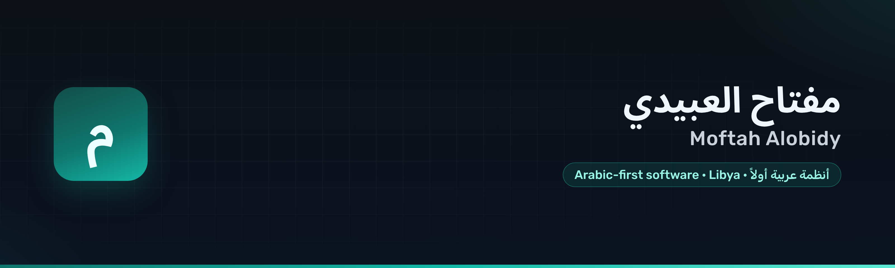

  

<h1 align="center">مفتاح العبيدي · Moftah Alobidy</h1>

<strong>أبني أنظمة أعمال عربية أولاً في ليبيا.</strong> 
I build Arabic-first business software in Libya.

  

I design and ship tools that work the way businesses here actually work — in Arabic, RTL-first, and ready for real shops and companies.

- **IPOS** — an Arabic-first point-of-sale and business system for restaurants, shops, pharmacies, and online stores. Built with Laravel, Filament, Livewire, and MySQL.
- **[Wajha](https://wajha.ly)** — واجهة, a Libya-based studio for websites, business systems, and online stores.

<!-- If ipos-system is made public, turn the IPOS line into: [IPOS](https://github.com/m0ftah/ipos-system) -->

## Stack

  

Also day to day: **Filament**, **Livewire**, and Prisma when the project is on Next.js.

## Featured work

| Project | What it is |
|---|---|
| **IPOS** | Arabic-first POS and business system for restaurants, shops, pharmacies, and online stores. |
| **[Wajha](https://wajha.ly)** | Studio site for websites, systems, and online stores in Libya. Live at [wajha.ly](https://wajha.ly). |
| **[Al-Moobda Al-Masi](https://github.com/m0ftah/al-moobda-al-masi-homepage)** | Bilingual Arabic/English company homepage (Vite, Tailwind) for an industrial and marine equipment importer. |
| **[V.M.P.S](https://github.com/m0ftah/vmps-homepage)** | Homepage for Vortex Multi Petroleum Services. |
| **[Tarek Dashboard](https://github.com/m0ftah/tarek-dashboard)** | Laravel + Filament + Livewire dashboard. |
| **[Employee search tool](https://github.com/m0ftah/employee-search-tool-)** | Laravel + Filament tool for searching employees. |
| **[Statement of account](https://github.com/m0ftah/statement-of-account)** | Next.js account-statement app with Arabic/English (next-intl). |

## Contact

- Email: [moftah0550@gmail.com](mailto:moftah0550@gmail.com)

<!-- Optional, more reliable than the old Vercel/Heroku widgets:

  

A public "top languages" card would currently over-represent CSS and C++ from older public repos, and would miss private IPOS work. Add it only after hiding those languages or counting private repos with a self-hosted card.
-->
